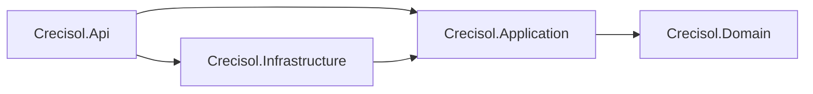

# CRECISOL — C03-01 · Inventario canónico y mapa de módulos y dependencias

**ESTADO VIGENTE: C03-01 CERRADA TÉCNICAMENTE Y APROBADA EXPRESAMENTE (1/10), condicionada a CI PREMERGE/POSTMERGE del acta de cierre; C03 NO CERTIFICADO y C04 BLOQUEADO.** [Acta C03-01 y 7/7 CI reales](C03_01_ACTA_MICROFASE.md). Se ejecuta solamente la primera microfase del capítulo 03 (**0/10** microfases cerradas al iniciar), sin abrir C03-02. Se trata de diseño verificable de límites y detección de acoplamientos sobre los proyectos existentes, **no** de implementar los módulos futuros. La aceptación de C02 está registrada y certificada como **2/37 capítulos**; [PR #48](https://github.com/solqaryn-platform/CRECISOL/pull/48), `dev` `342085ad323c9f24da5b2a197c41574376ac30f0`, [12/12 CI POSTMERGE](https://github.com/solqaryn-platform/CRECISOL/actions/runs/42685252655).

**AUTORIDAD:** el Documento Maestro Único `docs/CRECISOL_DOCUMENTO_MAESTRO_UNICO.docx`, hash SHA-256 `e45c2017e62bbbaa6853298efd5de5d785230005203d8791f791760f6f2c622e`, blob `214bf9c3d9763be23a77b7e0c464359584edde46`. La lectura desde el DOCX real, con delimitación `03. Arquitectura técnica limpia y dependencias` → `04. Multitenancy, dominios y aprovisionamiento`, fue ejecutada en GitHub Actions [C03-01 extracción #42687641345](https://github.com/solqaryn-platform/CRECISOL/actions/runs/42687641345) **SUCCESS**. La fuente posee **7 unidades textuales originales y una tabla original de nueve filas (cabecera + ocho componentes)**; los anexos añaden **2 tablas suplementarias de tres filas cada una**, que no se presentan como parte de la tabla original. No se modifica ni duplica el Maestro.

## 1. Separar puertas del Maestro y microfases técnicas

**DIF-C03-01:** `MAE-C03-01` Extraer, `MAE-C03-02` Diseñar, `MAE-C03-03` Codificar, `MAE-C03-04` Probar, `MAE-C03-05` Auditar A, `MAE-C03-06` Auditar B, `MAE-C03-07` Auditar C y `MAE-C03-08` Acta son **ocho puertas normativas de proceso** descritas en el Word; no equivalen a los **diez microentregables técnicos C03-01..10** del plan derivado. C03-01 inventaría la fuente y documenta el primer mapa con negativas. La secuencia técnica continúa estrictamente **C03-02..C03-09** y culmina en **C03-10** (auditoría integral y aprobación humana posterior); **no** se ejecutan ni certifican por redactar el mapa. Ninguna de las nueve microfases restantes está iniciada.

## 2. Matriz de trazabilidad: siete unidades textuales originales

| ID | Texto/tema verificable en el Word | Traducción de C03-01 y dependencia |
| --- | --- | --- |
| P01 | Monolito modular ASP.NET Core, vertical slices, Angular público/privado sobre un mismo design system, MySQL normalizado, workers y adaptadores reemplazables | Mapa conceptual; no crear microservicios ni nuevos procesos |
| P02 | 3.1. Árbol recomendado del repositorio | Identificar explícitamente que es una **propuesta**, no los archivos actuales |
| P03 | Árbol propuesto: `frontend/apps/public-web`, `admin-web`, `backend/src/Api`, `BuildingBlocks`, `Modules`, `Infrastructure`, `infra/` | Comparar con `frontend/`, `backend/src/Crecisol.*`, `database/` reales; no mover código ahora |
| P04 | 3.2. Dependencias y límites entre módulos | Grafo acíclico; ownership y contratos, no SQL sobre tablas ajenas |
| P05 | Identity, Tenants, Catalog, Orders, Payments, Scheduling, Memberships, Media, Analytics y flujo por puertos o aplicación | Diez módulos proyectados, incluido Cases del anexo G.7; todos **planificados**, no activos |
| P06 | 3.3. Decisiones abiertas | Respetar ADR-001..008, ADR-010; no resolver proveedores por inferencia |
| P07 | Objetivos Angular 22, Node 24, .NET 10, MySQL 8.4 LTS; EF Core/MySQL, SSR, proxy y VPS pendientes de compatibilidad/evaluación | Compilaciones y smoke de stack reales en CI, sin producción ni compra |

P03 está originalmente como nota de formato de árbol (`OriginalNote`), **sí** forma parte de las siete unidades de contenido; se excluye únicamente la nota editorial `FUENTE ORIGINAL`. El script `qa/c03_01_source.py` extrae y comprueba el texto directamente, no reconstruye el Word desde esta matriz.

## 3. Matriz de trazabilidad: tabla original

| ID | Capa o superficie original | Invariante y responsabilidad |
| --- | --- | --- |
| T01-R01 | Capacidad / regla — Comportamiento funcional — Control / aceptación | Cabecera original de tres columnas, no operación ejecutable |
| T01-R02 | Domain | Entidades/invariantes y eventos puros; sin HTTP/ORM/SDK |
| T01-R03 | Application | Casos de uso pequeños, validación/autorización y puertos; sin MySQL directo |
| T01-R04 | Infrastructure | Adaptadores reemplazables de MySQL, correo, pagos, archivos, social, clock |
| T01-R05 | API | Entradas HTTP tipadas, validación, errores, auth y controladores delgados |
| T01-R06 | Workers | Outbox, idempotencia, retry acotado, dead-letter y observabilidad futuros |
| T01-R07 | Frontend público | SEO, comercio/servicios/reservas y login contextual en capítulos posteriores; lazy y SSR por evaluar |
| T01-R08 | Frontend privado | Shell SuperAdmin/negocio/empleado/editor futuro, autorización **backend**, guards solo UX |
| T01-R09 | Shared contracts | DTO/eventos versionados, OpenAPI y compatibilidad sin referencias circulares |

**Anexos no confundidos con la tabla original:** T02-R01..03 resume Frontend/Backend/Base de datos; T03-R01..03 resume Domain/Application/Infrastructure. Se verifican como tablas suplementarias separadas de tres filas cada una. G.7 exige módulo **Cases** separado de Orders, Scheduling y Billing, con contratos/eventos versionados y outbox; su implementación y pruebas UC-029..UC-034 quedan pendientes.

## 4. Grafo físico actual observado — no diagramar el futuro como existente

El contrato JSON de respaldo [C03-01 mapa](C03_01_MODULOS_DEPENDENCIAS.json) contiene rutas y referencias **realmente presentes** en GitHub. Son proyectos .NET 10, no servicios de red:

- `Crecisol.Domain.csproj`: **sin ProjectReference ni PackageReference de infraestructura**.
- `Crecisol.Application.csproj`: depende solo de Domain.
- `Crecisol.Infrastructure.csproj`: depende solo de Application y admite MySqlConnector en adaptadores. Su dependencia transitiva con Domain no cambia la dirección de los puertos.
- `Crecisol.Api.csproj`: composición de Application + Infrastructure. Solo el endpoint público `GET /api/v1/public/branding/platform` está implementado.
- `frontend/angular.json`: **una aplicación pública Angular real** + `pattern-harness` sintético aislado; rutas `/`, `/experiencias`, `/demostraciones`, `/alta-empresas`, `**` 404. Los workspaces `public-web/admin-web` propuestos en el Word **no** existen aún como aplicaciones separadas.
- `database/c01_03_brand_schema.sql`: modelo publicado de marca de C01; esto **no** implementa persistencia multitenant privada completa, routing SHARED/DEDICATED ni módulos de negocio.

**Futuros módulos / owner por dominio:** Identity (identidad), Tenants (membresía, dominios y autorización), Catalog (catálogo), Orders (pedidos), Payments (intención/conciliación), Scheduling (agenda), Memberships (derechos), Media (metadatos), Analytics (proyecciones), Cases (seguimiento G.7 independiente). Todos se marcan `planned` en el contrato. Ninguno puede escribir tablas propiedad de otro módulo sin puerto/contrato transaccional autorizado. No confundir *servicio pequeño* con microservicio externo.

## 5. Seguridad multitenant y parametrización — invariantes no implementados

- **P0:** ningún Domain/Application compone DSN, toma `tenant_id` de query o header como permiso, omite `TenantContext`, lee/escribe tablas ajenas sin contrato o se salta verificación de acción/sucursal/recurso. El actual endpoint público solo lectura no acredita BOLA/IDOR real para módulos privados inexistentes.
- Domain sin HTTP/ORM/SDK; Application depende de puertos, nunca instancia MySqlConnector; Infrastructure encapsula conexiones/tiempos de espera; API valida host/inputs y permanece sin nuevas rutas privadas en C03-01. No cambiar la implementación existente.
- Parametrización futura integral de logo, cabecera, pie, temas, textos, formularios y tablas por `platform/tenant/branch/user` con preview, versión, aprobación y rollback; configuración nunca concede permisos ni ejecuta JS/CSS/HTML/SQL desde un tenant.
- Login normal sin selector de empresa, ambigüedad denegada; SuperAdmin excepcional con MFA, motivo, vigencia y auditoría; eventos, cache, colas, medios y backups aislados. Son **obligaciones transversales futuras**, no características activas probadas en C03-01.
- El anexo cita TEN-001/TEN-002/TEN-008/TEN-009/TEN-010/TEN-021/TEN-032. Para este inventario sin operaciones privadas: *NO APLICA como prueba runtime de tenancy*; sí se comprueban dependencias/ausencia de activación. UC-029..UC-034 para Cases permanecen planeados.

## 6. Pruebas, auditorías, negativos y puerta de cierre

| Control | Evidencia a ejecutar en CI C03-01 | Límite de la afirmación |
| --- | --- | --- |
| A — función/trazabilidad | SHA Word y C03/C04, siete unidades P01..07, nueve filas T01-R01..09, dos tablas anexas, 16 IDs únicos y diez amenazas de contrato; mutaciones de cobertura | Inventario, **no** módulos futuros programados |
| B — seguridad/aislamiento | Construir grafo y rechazar ciclos, referencias inversas/ORM en Domain/Application, DSN de cliente, propiedad cruzada, inicio de C04, casos futuros marcados implementados | No sustituye BOLA/IDOR/MFA ni datos tenant reales |
| C — arquitectura/rendimiento | Verificar los cuatro .csproj y `ProjectReference` reales, rutas Angular, bundles prod/harness separados, TypeScript/Angular22, .NET10 Release, Domain/Application, regresión pública MySQL8.4 desechable | Build/contratos públicos reales, **no** benchmark productivo ni workers futuros |

**Negativas contractuales:** `NEG-01` ciclo, `NEG-02` dependencia de infraestructura en Domain, `NEG-03` MySQL en Application, `NEG-04` escritura cruzada, `NEG-05` DSN desde navegador, `NEG-06` rutas privadas activadas, `NEG-07` Worker/outbox declarado ejecutable, `NEG-08` Cases fusionado con Orders/Scheduling/Billing, `NEG-09` C03/C04 avanzado antes del gate, `NEG-10` confundir propuesta y código. Las mutaciones deben ser **rechazadas** para acreditar el contrato, sin inventar que esas superficies ya funcionan.

**Alcance de archivos C03-01:** `docs/c03/`, `docs/C03_PREPARACION.md`, estado planificado C03 en `docs/PLAN_37_CAPITULOS.md`, propuesta C03, `qa/c03_01_source.py`, workflow C03-01 y ajuste de compatibilidad del gate C02 para permitir empezar C03 tras certificación. **Cero cambios** a `frontend/src/`, `backend/src/`, `database/`, rutas, API, DTO, migraciones, worker, `main`, SOLQARYN o producción.

**Resultado de microfase, no capítulo:** PR técnico #49 fusionado a `dev` SHA `7217fb1e720f16c71d5a654f605eca96d81deb58` con **7/7 CI POSTMERGE SUCCESS**; auditorías A/B/C y diez negativas aprobadas, acta y aceptación humana literal registradas. **C03-01 CERRADA TÉCNICAMENTE (1/10)** tras comprobar CI propia del acta; hasta ese gate es una aprobación de formalización pendiente. **Capítulo C03 NO CERTIFICADO**, C04 bloqueado. **Rollback:** revert por PR en `dev` de documentos/QA/workflow, sin migración ni impacto productivo.

**Importante:** los resultados `SUCCESS` de Word inicial #42687641345 acreditan **solo extracción canónica**, no las auditorías ni builds finales de esta microfase.
